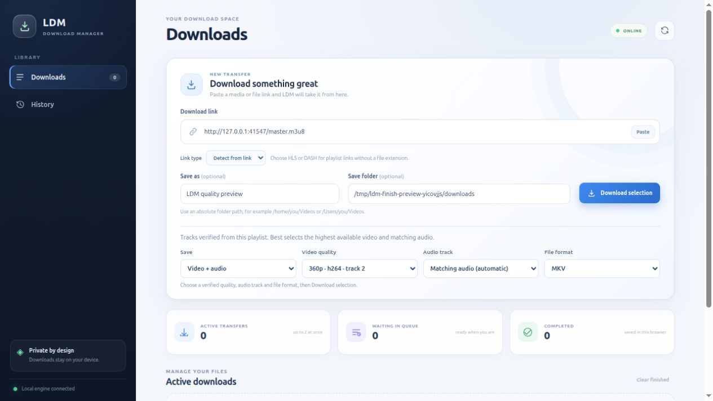

# LDM — Local Download Manager

[](https://github.com/iamsaiam/LDM/actions/workflows/build.yml)
[](LICENSE)

An open-source download manager for **Linux and macOS**, with a native C++ engine,
a local dashboard and browser integration for Chromium and Firefox.



## Features

- **Parallel transfers:** verified HTTP ranges, up to eight workers, retries,
  sequential fallback, and validated reuse of partial downloads.
- **Transfer controls:** Pause, Resume and Cancel from the dashboard, extension
  popup or player overlay. Direct transfers show size, rate, percentage and ETA.
- **Media discovery:** browser response metadata, native video/audio sources,
  embedded frames and extensionless media endpoints.
- **Quality and audio selection:** inspect HLS/DASH tracks, choose an available
  resolution and audio track, then save MP4/MKV or audio-only M4A/MP3/Opus.
- **Local history:** recover the browser view and reconnect to active engine jobs.
  Existing output files are preserved using numbered filenames.
- **HTTP, HTTPS, FTP and FTPS:** availability follows the native libcurl build.
  Media processing uses qualified FFmpeg/ffprobe helpers.

Available quality depends on the source. Playlist processing reports output bytes;
network rate and ETA are available for direct file transfers. A detected media URL
still needs to be accessible and playable. DRM, access-control bypass and universal
website extraction are outside the supported scope.

## Get started

```sh
git clone https://github.com/iamsaiam/LDM.git
cd LDM
```

### 1. Install build dependencies

Use a C++20 compiler, CMake 3.16+, Python 3.9+ and Node.js 18+.

**Debian / Ubuntu**

```sh
sudo apt install build-essential cmake libcurl4-openssl-dev python3 nodejs \
  pkg-config nasm libgnutls28-dev libx264-dev libmp3lame-dev libopus-dev libxml2-dev
```

**macOS** — install Apple's Command Line Tools first:

```sh
xcode-select --install
brew install cmake curl node python pkgconf nasm gnutls x264 lame opus libxml2
export PKG_CONFIG_PATH="$(brew --prefix libxml2)/lib/pkgconfig:${PKG_CONFIG_PATH:-}"
export CURL_ROOT="$(brew --prefix curl)"
```

### 2. Build the media helpers

The builder downloads official FFmpeg 9.0.2, checks a pinned checksum, applies the
included TLS inheritance patch and builds into a new local directory. It keeps the
source, patch and licenses with the resulting helpers.

```sh
python3 scripts/build_media_helper.py --download --output-dir media-helper-build --jobs 3
export PATH="$PWD/media-helper-build/runtime/bin:$PATH"
```

Keep that directory on the engine's `PATH` when using streaming features. Direct
file downloads work without media helpers. See the [helper guide](packaging/media-helper/README.md)
for an offline source tarball, dependencies and certificate qualification.

### 3. Build and check LDM

```sh
python3 scripts/check_dependencies.py
cmake -S cpp-engine -B build-release -DCMAKE_BUILD_TYPE=Release -DBUILD_TESTING=ON
cmake --build build-release --parallel 3
ctest --test-dir build-release --output-on-failure
node --test extension/tests/*.test.cjs desktop-ui/tests/*.test.cjs
```

### 4. Open the app

```sh
# Linux
./build-release/ldm-downloader --app

# macOS
./build-release/LDM.app/Contents/MacOS/LDM --app
```

The embedded dashboard runs locally in your browser at `http://127.0.0.1:12345`.
Supporting browsers can install it as a PWA. Use `--server` to run the engine for
the extension without opening the dashboard.

For direct command-line downloads:

```sh
./build-release/ldm-downloader "https://example.org/file.zip" "/absolute/path/file.zip"
```

Use the macOS executable path above on a Mac. To set the default browser-download
folder, set `LDM_DOWNLOAD_DIR=/absolute/folder` on the engine process. Otherwise,
bare filenames go to your Downloads directory. The dashboard also accepts an
absolute save-folder path.

## Browser extension

Keep LDM running, then load the matching browser package:

| Browser | Development installation |
| --- | --- |
| Chromium / Chrome | `chrome://extensions` → Developer mode → Load unpacked → `extension/` |
| Firefox | Create the Firefox ZIP with the packaging script, extract it, then select its `manifest.json` in `about:debugging` → This Firefox → Load Temporary Add-on |

The popup lists detected media. Choose a playlist to inspect its tracks before
downloading. Native players can also show an LDM overlay with live controls.

Firefox temporary add-ons expire when the browser restarts. Permanent Firefox
installation needs Mozilla signing. The [release guide](RELEASE.md) explains
browser packages, installation and distribution.

## Project structure

| Directory | Purpose |
| --- | --- |
| `cpp-engine/` | C++20/libcurl transfer engine, local API and integration checks |
| `desktop-ui/` | Embedded dashboard and PWA |
| `extension/` | Browser discovery, popup, player overlay and shared UI logic |
| `scripts/` | Dependency checks, browser fixtures, native verification and packaging |
| `packaging/` | Linux launcher, macOS app resources and media helper patch |
| `benchmarks/` | Repeatable local and bounded remote measurements |
| `docs/` | Verification records, screenshots and archived measurements |
| `backend/` | Separate experimental Flask/yt-dlp service; unused by the native app |

## Verification and releases

[GitHub Actions](https://github.com/iamsaiam/LDM/actions/workflows/build.yml) builds
and checks Linux, Apple Silicon macOS and Intel macOS. The verification record
identifies completed runs and their scope. Linux installed-extension checks cover
Chrome 155, Chromium 151 and Firefox 158 with generated authenticated media.

Native packages currently use system dependencies. macOS packages are unsigned
and unnotarized; browser store distribution is separate. Follow the
[release guide](RELEASE.md) for installation, reproducible archives and SHA-256
checksums. Engine and extension packages currently have separate version numbers.

- [Verification record](docs/VERIFICATION.md)
- [Implementation details](PROGRESS.md)
- [Performance measurements](benchmarks/README.md)
- [Repeatable installed-browser checks](scripts/browser-tests/README.md)
- [Contributing](CONTRIBUTING.md) · [Changelog](CHANGELOG.md) · [Security reporting](SECURITY.md)

Synthetic local throughput measures the documented fixture conditions. A controlled
IDM/XDM comparison has not been completed.

## Privacy and license

The dashboard uses local assets. The extension requests site and cookie access to
identify media and authenticate user-selected transfers. Source URLs and captured
headers stay in temporary browser-session state; persistent history stores
transfer metadata. Required request data goes to the local engine when you choose
to inspect or download. Engine job state clears when its process exits.

LDM source is [MIT licensed](LICENSE). FFmpeg and other dependencies retain their
own licenses; the helper build keeps FFmpeg source, its patch and GPL license.
